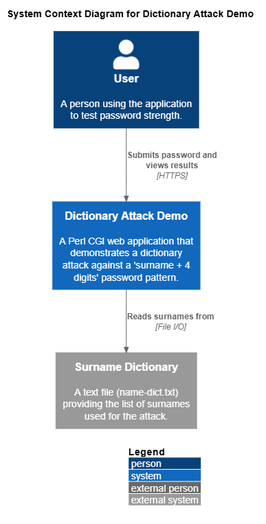

# Dictionary Attack improvement

I coded this project as part of my cybersecurity practical training in Ichinoseki, Japan.
I attended National Institute of Technology, Ichinoseki College from 24.4.2025 to 24.7.2025.

## Overview
This project implements a dictionary attack algorithm using HASH-based approach instead of nested loops.

## Usage
1. I used Windows, which means the Perl setup might differ by OS.
    Example: instead of using `#!/usr/bin/perl`, I installed Strawberry Perl and used the full path shebang on the first line.

2. Shebang by platform:
    - Windows: `#!C:/Strawberry/perl/bin/perl.exe` (adjust to your Strawberry Perl install path)
    - macOS/Linux: `#!/usr/bin/perl`

3. Line endings: CGI files should use LF. A `.gitattributes` file is included to enforce LF for `.cgi/.pl/.pm` files. If editing in VS Code on Windows, also set the file's EOL to LF.

4. Deploy to your local web server:
    - Copy `dict_attack_org.cgi` and `name-dict.txt` to your server's `cgi-bin` (with execute permissions on macOS/Linux).
    - On Windows with XAMPP, place both files under `xampp\cgi-bin\`.

5. Run the local Apache server (e.g., via XAMPP Control Panel on Windows) and open the CGI in your browser, for example:
    - `http://localhost/cgi-bin/dict_attack_org.cgi`

6. At the time of implementation:
    - Perl: v5.40.2
    - XAMPP: v3.3.0

## Code improvements
- Original nested loop approach: O(n * 10^4) time complexity (4 'for' loops)
- New hash-based approach: O(n) complexity to build dictionary + O(1) for lookup

## Details
The logic behing hash-based approach:
1. It loads all the surnames from name-dict.txt into a Perl hash table
2. It extracts the surname part from the input password
3. Uses a direct hash lookup (O(1)) to check if the surname exists in the table
4. This eliminates the need for 10,000 different comparisons per surname + 4 digits combination

## Results
- "ookubo9999" (first surname in dictionary): ~50ms
- "warita9999" (last surname in dictionary): ~55ms instead of ~21 seconds
- Performance is consistent. Note! the performance can vary 10-50ms sometimes mainly due to operating system scheduling (the script competes with other processes for CPU time), system resource limitations (available memory can change between inputs) or hash function behavior (hash collisions). In my case, using local Apache server via XAMPP might have impacted the performance.

## Files included
- dict_attack_org.cgi: implemantation with hash-based approach. Original nested loop code is commented out but exists in the file
- name-dict.txt: dictionary file that contains the surnames
- C4_system_diagram.puml: showing the structure
- Dictionary_attack_diagram.png: showing the diagram as a png
- README.md: for additional info and help
 - .gitattributes: enforce LF for Perl/CGI files across platforms
 - .gitignore: ignore OS/editor artifacts (e.g., Desktop.ini, .vscode/)
 - LICENSE: MIT license

## Diagram

## More info about hash-tables
For more info about hash-tables and Perl data types, please visit the following websites:
1. Perl data structures: https://perldoc.perl.org/perldsc#HASHES-OF-HASHES 
2. Perl data types: https://perldoc.perl.org/perldata#Hashes
3. Perl Hash tutorial: https://www.perltutorial.org/perl-hash/

## Author and date
18.6.2025
Jesse Partonen
National Institute of Technology, Ichinoseki College
